# Biblioteca IPF

App integradora del Taller Complementario React Native II (TP 4). Los alumnos consultan el catalogo,
reservan libros y reciben un recordatorio antes de devolverlos; el personal entrega los libros respetando
el orden de las reservas.

- Alumno: Santiago Ayala
- SDK de Expo: **58** (`expo ~58.0.26`, `expo-router ~58.0.32`, `react-native 0.88.1`, React 19.3)
- Respuestas de las Partes B a E: [`RESPUESTAS.md`](RESPUESTAS.md)
- Proceso de desarrollo (especificacion, plan, tareas y trazabilidad): [`docs/sdd/`](docs/sdd/)
- Proyecto creado con `npx create-expo-app@latest` (TypeScript + Expo Router). Paquetes instalados con `npx expo install`.

## Como ejecutarlo

```bash
npm install
npx expo start        # escanear el QR con Expo Go (Android o iOS)
```

Otros comandos:

```bash
npm test              # tests de Pila, Cola y reglas de negocio (jest-expo)
npx expo lint         # lint
npx tsc --noEmit      # chequeo de tipos
npx expo start --web  # version web (solo para revisar navegacion y estados; sin camara)
```

Credenciales del personal (fijas en `src/constants/app.ts`): usuario `biblioteca`, clave `ipf2026`.
La persona usuaria de la app es `Santiago` (`USUARIO_ACTUAL`).

## Rutas (`src/app`)

```
src/app/
|-- _layout.tsx                 Stack raiz (provee el Context; Stack.Protected; anchor '(tabs)')
|-- (tabs)/
|   |-- _layout.tsx             Tabs (Tabs de expo-router + Ionicons)
|   |-- (catalogo)/
|   |   |-- _layout.tsx         Stack propio de la tab Catalogo (anchor 'index', link "Personal")
|   |   |-- index.tsx           /                 Catalogo
|   |   `-- libro/[isbn].tsx    /libro/[isbn]     Detalle
|   `-- reservas.tsx            /reservas         Mis reservas
|-- buscar.tsx                  /buscar?q=        Buscador (Stack raiz)
|-- escanear.tsx                /escanear         Escaner (Stack raiz)
|-- reservar/[isbn].tsx         /reservar/[isbn]  Confirmacion (modal)
|-- permisos/[recurso].tsx      /permisos/[recurso] Pantalla previa (modal)
|-- login.tsx                   /login            Solo sin sesion (modal, Stack.Protected)
|-- mostrador.tsx               /mostrador        Solo con sesion (Stack.Protected)
|-- reserva.tsx                 /reserva          <Redirect href="/reservas" />
`-- +not-found.tsx              cualquier otra    404 con la URL inexistente
```

## Estructura del resto de `src`

| Carpeta | Contenido |
|---|---|
| `components/` | Componentes presentacionales, uno por archivo (botones, tarjetas, estados de pantalla) |
| `hooks/` | `useLibros`, `useBusqueda` (`useSearch.ts`), `usePermiso` (`usePermission.ts`) |
| `lib/` | `api.ts` (entregado), reglas de negocio puras (`library.ts`), catalogo, fechas, permisos, notificaciones |
| `context/` | Estado global: prestamos, listas de espera, recientes, sesion y avisos |
| `estructuras/` | Clases `Pila` y `Cola` con `#items`, `tamanio` y `aArray()` |
| `data/` | `libros.ts` (15 libros y listas de espera iniciales) |
| `types/` | Tipos de dominio |
| `constants/` | `tema.ts` (paleta, espaciados, tamanios), constantes de la app y de navegacion |

Regla de dependencias: `app -> components / hooks / context -> lib -> estructuras / data / types / constants`.
Ningun archivo fuera de `src/app` importa desde `src/app`.

## Plugins de `app.json`

```jsonc
"plugins": [
  // Rutas basadas en archivos.
  "expo-router",
  // Splash con el fondo de la paleta.
  ["expo-splash-screen", { "backgroundColor": "#1B1B1B", "image": "./assets/images/splash-icon.png", "imageWidth": 76 }],
  ["expo-camera", {
    // Texto de proposito con el molde "Usamos tu [dato] para [beneficio concreto]".
    "cameraPermission": "Usamos tu camara para leer el codigo de barras del libro y abrir su ficha al instante",
    // Minimo privilegio: el escaner no graba video, asi que no se pide microfono.
    "microphonePermission": false,
    "recordAudioAndroid": false,
    // Lector de codigos de barras habilitado (EAN-13).
    "barcodeScannerEnabled": true
  }],
  // Notificaciones locales; color de acento en Android.
  ["expo-notifications", { "color": "#FC6E20" }]
]
```

## Permisos

| Recurso | Modulo | Cuando se pide | Alternativa si se niega |
|---|---|---|---|
| Camara | `expo-camera` (`useCameraPermissions`) | Al tocar "Activar camara" en `/escanear`, despues de la pantalla previa `/permisos/camara` | Escribir el ISBN a mano en la misma pantalla |
| Notificaciones | `expo-notifications` | Solo al activar "Recordarme" en un prestamo, despues de `/permisos/notificaciones` (el canal `prestamos` se crea antes de pedir) | Los avisos aparecen dentro de la app, en `/reservas` |

La app no usa `expo-permissions`, `expo-location` ni `expo-image-picker`.

### `blockedPermissions` (Android)

| Permiso bloqueado | Por que |
|---|---|
| `RECORD_AUDIO` | La camara solo lee codigos de barras; nunca graba video con audio. |
| `ACCESS_FINE_LOCATION`, `ACCESS_COARSE_LOCATION` | La app no necesita saber donde esta la persona. |
| `READ_EXTERNAL_STORAGE`, `WRITE_EXTERNAL_STORAGE` | No se leen ni guardan archivos o fotos. |
| `SYSTEM_ALERT_WINDOW` | La app no dibuja sobre otras apps. |

Verificado con `npx expo config --type introspect`: el manifest final declara `CAMERA` y marca los permisos anteriores con `tools:node="remove"`.

## Deep links de prueba

Con la app compilada se usa el esquema `bibliotecaipf://`. En Expo Go se usa `exp://IP:8081/--/` + la ruta.

| Link | Que deberia pasar |
|---|---|
| `bibliotecaipf://libro/9789507001017` | Detalle de "Ficciones", con el Catalogo debajo |
| `bibliotecaipf://libro/123` | Mensaje "\"123\" no es un ISBN valido: tiene que tener 13 digitos, sin guiones." con boton al Catalogo |
| `bibliotecaipf://buscar?q=borges` | Buscador con los libros de Borges y las tabs debajo |
| `bibliotecaipf://mostrador` (sin sesion) | Redirige al Catalogo (Stack.Protected) |
| `bibliotecaipf://reserva` | Redirige a `/reservas` |
| `bibliotecaipf://escanear` (camara bloqueada) | Escaner con aviso y el ingreso manual del ISBN |
| `bibliotecaipf://cualquier-cosa` | Pantalla 404 que muestra la direccion `/cualquier-cosa` |

Para abrirlos desde afuera de la app sin cable USB, genere un codigo QR por cada link con `npx qrcode "exp://IP:8081/--/libro/123"` y lo escanee con Expo Go.

## Capturas

Saque todas las capturas en mi celular Android con Expo Go. Los archivos estan en `docs/screenshots/`. Abajo explico que muestra cada una, por que la elegi y cuales no pude sacar.

### Catalogo

| Cargando | Con error | Con datos | Con vistos recientemente |
|---|---|---|---|
| 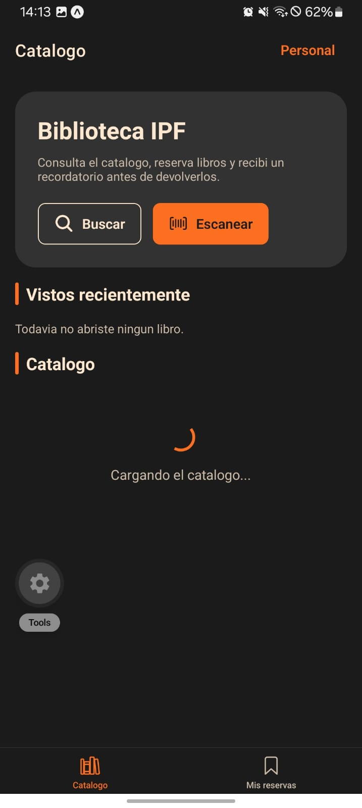 | 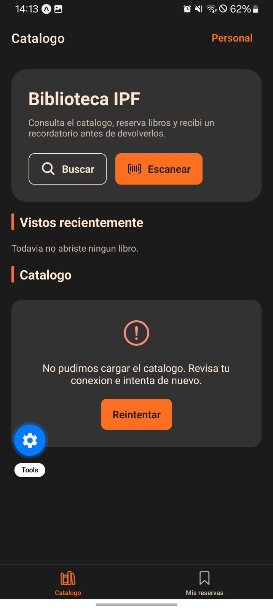 | 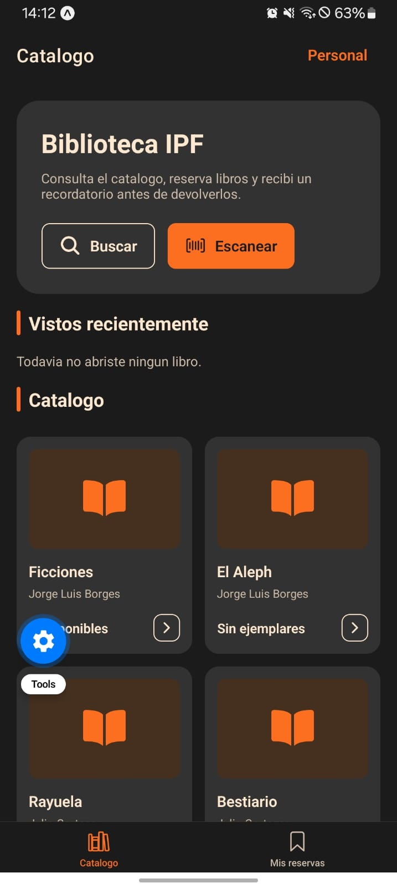 | 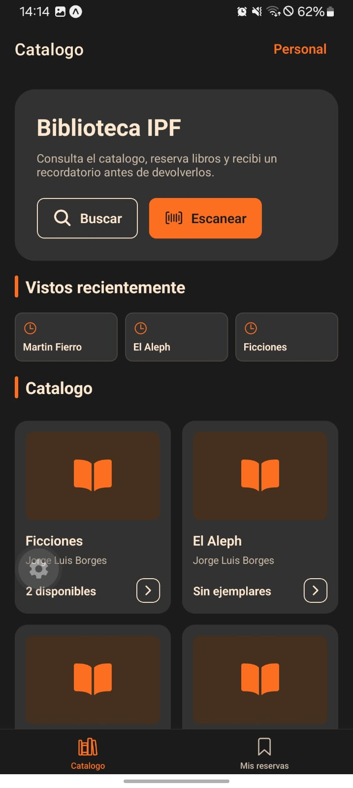 |

- **Cargando:** es el estado del primer render de `useLibros` (`cargando = true`). La API simulada tarda 800 ms, asi que alcance a capturarlo al abrir la app.
- **Con error:** `obtenerLibros()` falla 1 de cada 5 veces. Recargue la app varias veces hasta que fallo. Muestra el mensaje amigable y el boton "Reintentar".
- **Con datos:** la grilla del catalogo con los disponibles calculados ("2 disponibles", "Sin ejemplares").
- **Con vistos recientemente:** no la pide la consigna, pero la agregue porque muestra la Pila en uso. Abri Ficciones, El Aleph y Martin Fierro, y aparecen del mas reciente al mas antiguo.

### Buscador

| Sin texto | Con resultados (`borges`) | Sin resultados |
|---|---|---|
| 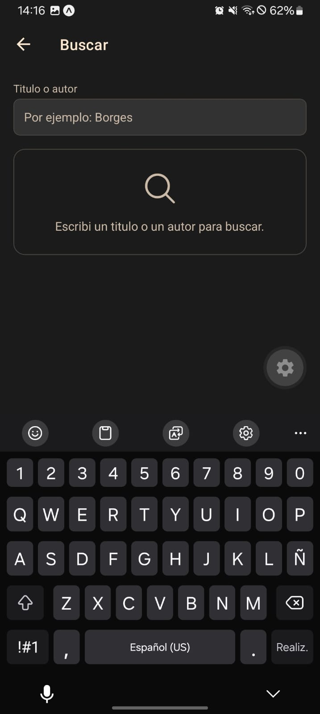 | 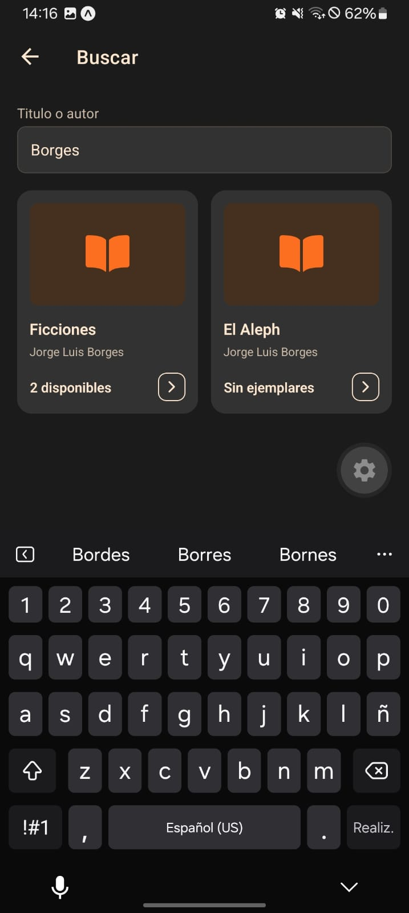 | 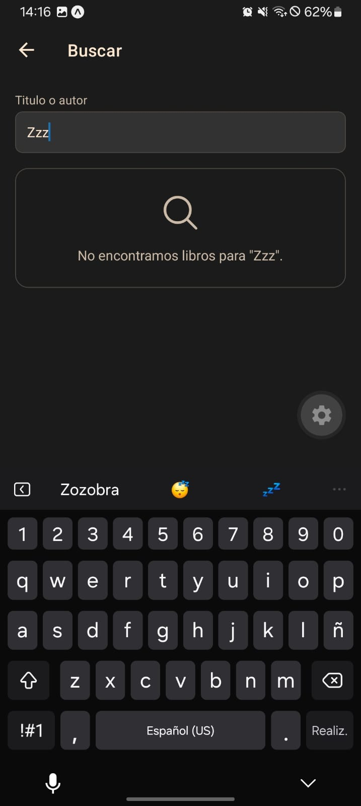 |

La que pide la consigna es la de resultados: escribi "Borges" y aparecen solo Ficciones y El Aleph. Las otras dos muestran los mensajes que ve la persona antes de escribir y cuando no hay coincidencias ("Zzz").

### Detalle inexistente

| ISBN invalido (deep link `/libro/123`) |
|---|
| 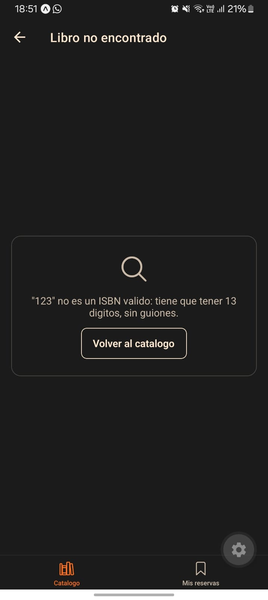 |

La abri con un deep link (un QR con `exp://IP:8081/--/libro/123` escaneado desde Expo Go). Muestra que la pantalla de detalle valida el parametro y ofrece volver al catalogo. Abajo se ve la tab Catalogo: el detalle quedo dentro de su pila.

### Reservas

| Con ejemplares (prestamo) | Sin ejemplares (lista de espera, posicion 3) |
|---|---|
| 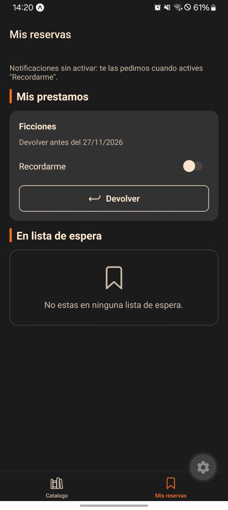 | 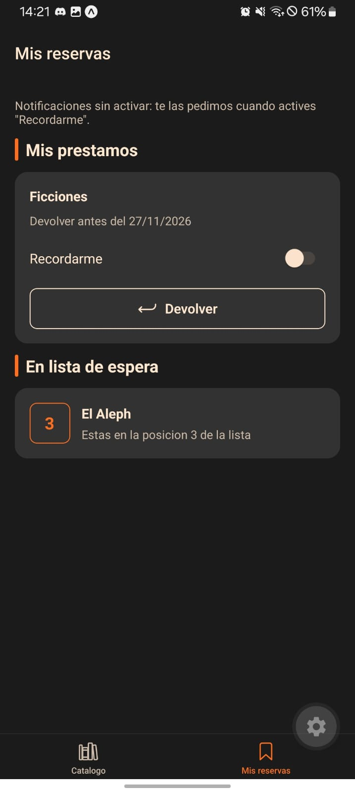 |

- **Con ejemplares:** reserve Ficciones, que tenia 2 ejemplares. Queda como prestamo con fecha de devolucion a 7 dias (27/11/2026).
- **Sin ejemplares:** reserve El Aleph, que tiene 0 ejemplares y ya tenia 2 personas esperando (Lucia y Mateo). Quedo en la posicion 3 de la Cola.

### Escaner y permiso de camara

| Pantalla previa y dialogo del sistema | Bloqueado | Concedido |
|---|---|---|
| 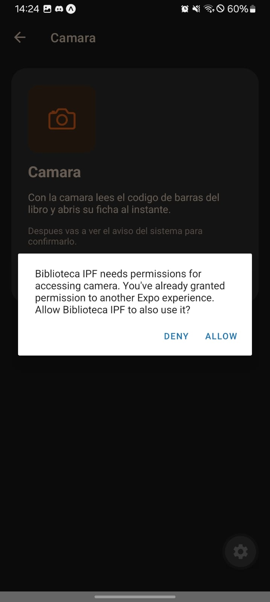 | 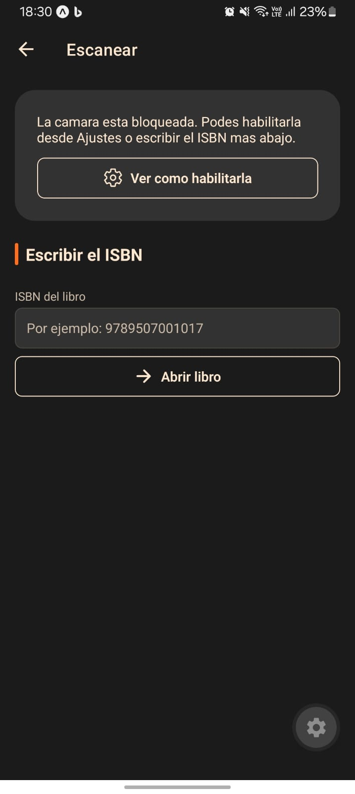 | 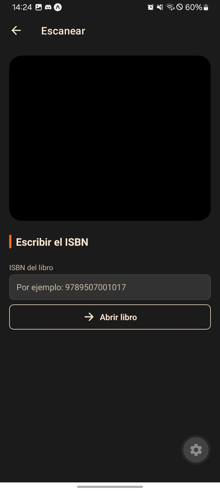 |

- **Pantalla previa y dialogo:** es lo que pasa al tocar "Activar camara" cuando el permiso esta en estado `preguntable`. Se ve el beneficio en una frase, la aclaracion "Despues vas a ver el aviso del sistema" (que solo aparece en ese estado) y encima el dialogo. El dialogo es el de Expo Go, no el mio (lo explico en D3 c de `RESPUESTAS.md`).
- **Bloqueado:** despues de decir "No permitir" dos veces. Muestra el aviso, el boton "Ver como habilitarla" y el ingreso manual del ISBN.
- **Concedido:** el recuadro de la camara con el ingreso manual debajo. En la captura el recuadro sale negro, pero ese panel solo aparece cuando el permiso esta concedido, y en el telefono la camara se activo sin errores.

### Notificaciones

| Recordatorio activado | Notificacion recibida |
|---|---|
| 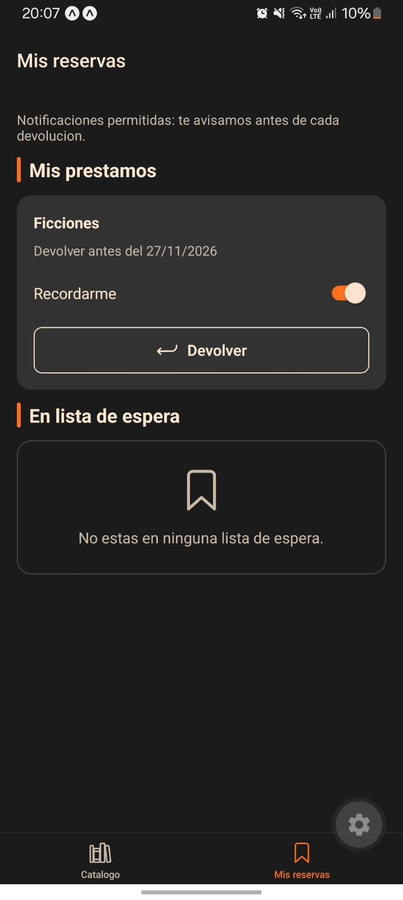 | 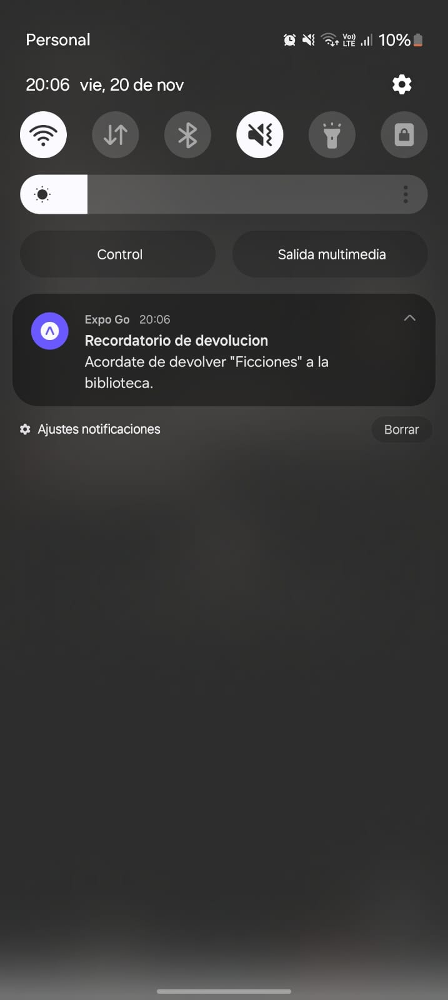 |

- **Recordatorio activado:** el interruptor "Recordarme" encendido y, arriba, el estado del permiso: "Notificaciones permitidas: te avisamos antes de cada devolucion".
- **Notificacion recibida:** llego 15 segundos despues de activar el interruptor, con la app en segundo plano. Dice "Expo Go" y no "Biblioteca IPF" porque la probe en Expo Go.

### Mostrador

| Antes de "Entregar al siguiente" | Despues de entregar todas las esperas |
|---|---|
| 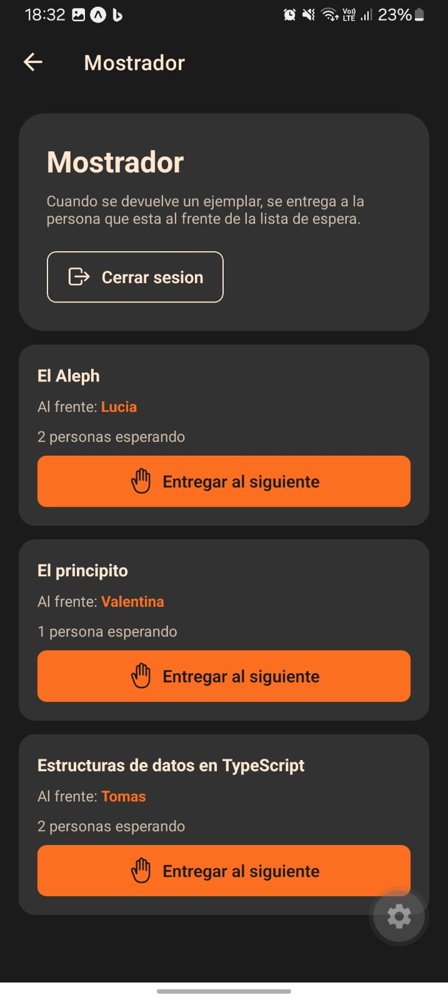 | 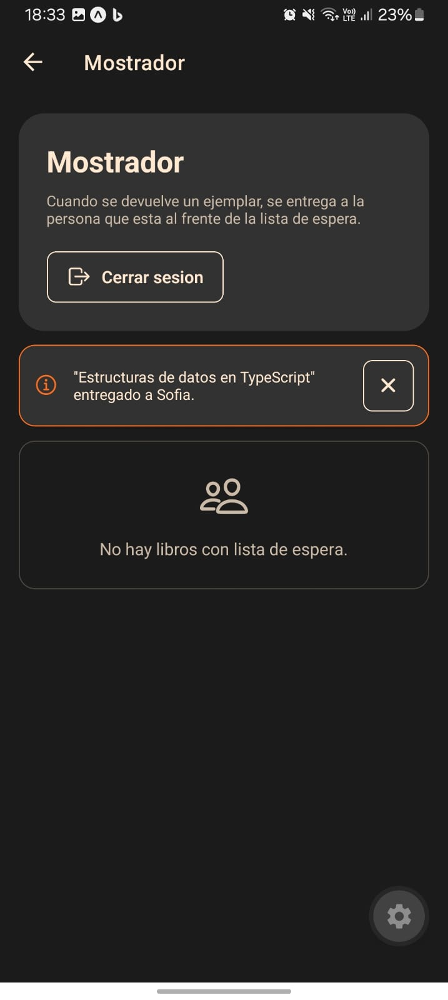 |

- **Antes:** los tres libros con lista de espera, con quien esta al frente y cuantas personas esperan.
- **Despues:** toque "Entregar al siguiente" hasta vaciar las colas. La ultima entrega fue "Estructuras de datos en TypeScript" a Sofia, y como no quedo nadie esperando aparece el estado vacio.

### Pantalla 404

| Deep link `/cualquier-cosa` |
|---|
| 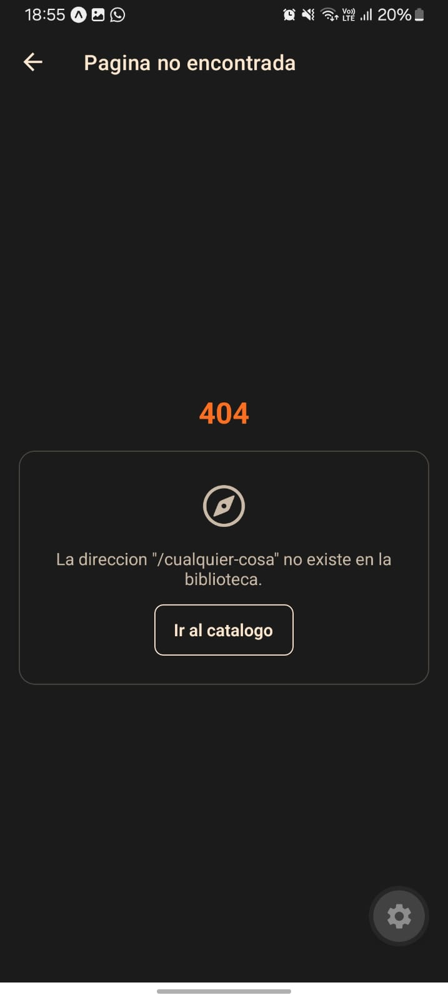 |

Tambien la abri con un QR. Muestra la direccion que no existe y el boton para volver al catalogo.

### Capturas que faltan y por que

- **Escaner en estado "cargando" ("Consultando la camara..."):** dura lo que tarda el sistema en responder si el permiso esta concedido, que en mi celular es menos de un segundo. No llegue a capturarlo, y mi celular no permite grabar la pantalla para sacar un cuadro del video. El estado existe en el codigo: es el valor inicial del panel en `src/app/escanear.tsx:46`, y `usePermiso` lo devuelve mientras la respuesta del permiso es `null` (`src/lib/permissions.ts:11-13`, con su test en `__tests__/permissions.test.ts`).
- **Escaner en estado "preguntable" (el panel "Activar camara" adentro del escaner):** no la tengo como captura del escaner. Lo que si tengo es la pantalla previa con el dialogo (captura 11), que solo se ve con el boton "Continuar" y el texto "Despues vas a ver el aviso del sistema" cuando el estado es `preguntable`. Es la misma situacion vista un paso despues.
- **Dialogo de camara con mi texto de proposito (desafio opcional):** no lo hice porque necesita un development build. En Expo Go el dialogo es el de Expo Go, como se ve en la captura 11.

## Decisiones de diseno

- **Pila y Cola sin mutar el estado:** cada accion crea una instancia nueva desde `aArray()` (`src/lib/library.ts`) y el Context la guarda con `setState`.
- **Ejemplares disponibles calculados**, no guardados: `calcularDisponibles(libro, prestamos)`.
- **Buscador sin carreras:** el efecto de `useBusqueda` espera 300 ms (debounce) y en la limpieza cancela el temporizador y descarta la respuesta vieja.
- **SOLID:** cada archivo con una responsabilidad (S); los recursos de permiso se describen en `RECURSOS_PERMISO` (O); `Pila` y `Cola` cumplen `EstructuraLineal<T>` (L); componentes con props minimas (I); las pantallas dependen de hooks y de `lib`, nunca de `expo-notifications` ni de la API directamente (D).
- **Diseno visual:** tema oscuro con la paleta `#1B1B1B`, `#323232`, `#FFE7D0` y `#FC6E20`. Todos los textos superan el contraste 4.5:1; los botones naranjas usan texto oscuro.
- **Proceso:** desarrollo guiado por especificaciones y verificacion de resultados (SDD + ODD). Ver `docs/sdd/`.

## Calidad

Salida al cierre del desarrollo:

```text
$ npx expo lint
(sin errores ni advertencias)

$ npx tsc --noEmit
(sin errores)

$ npm test
Test Suites: 4 passed, 4 total
Tests:       34 passed, 34 total

$ npx expo-doctor
20/20 checks passed. No issues detected!
```
